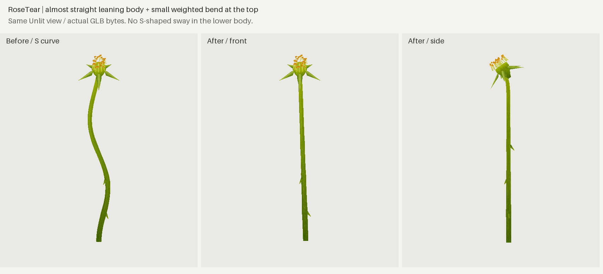
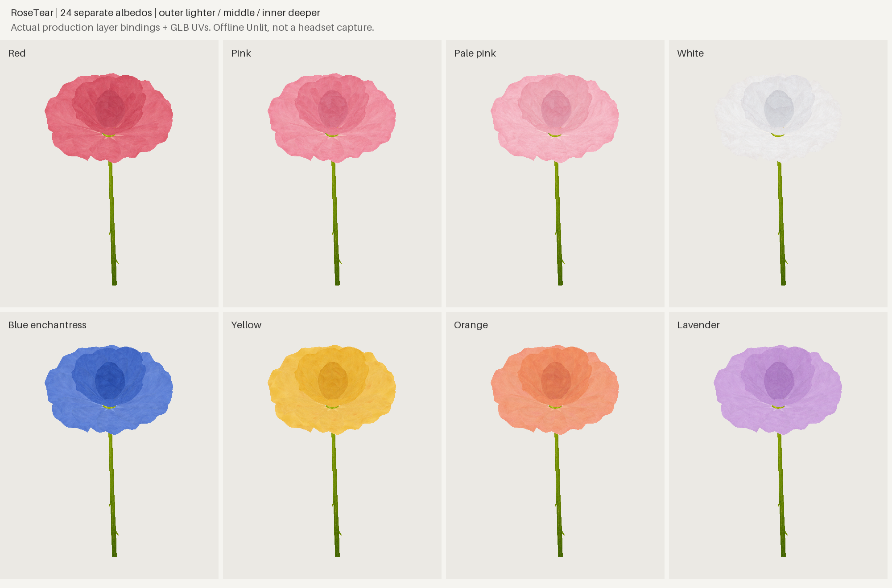
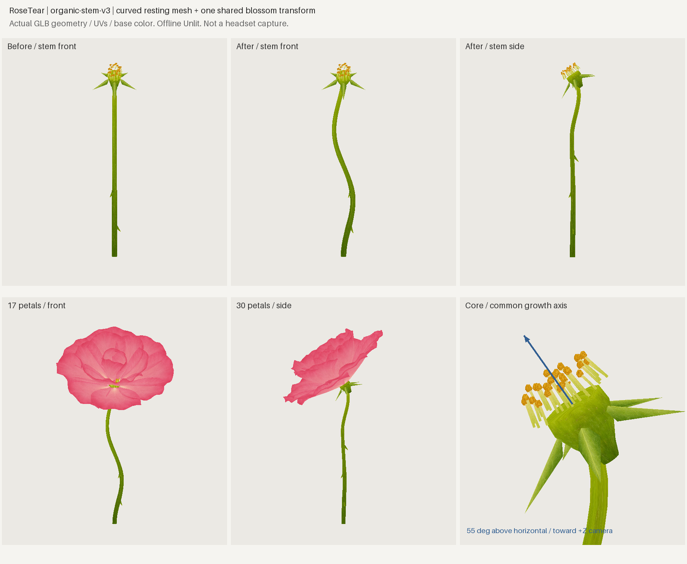
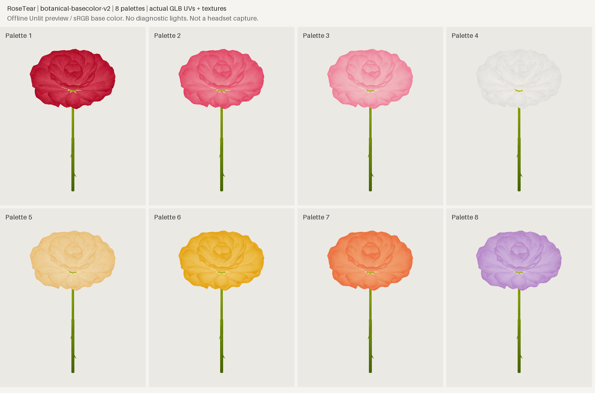
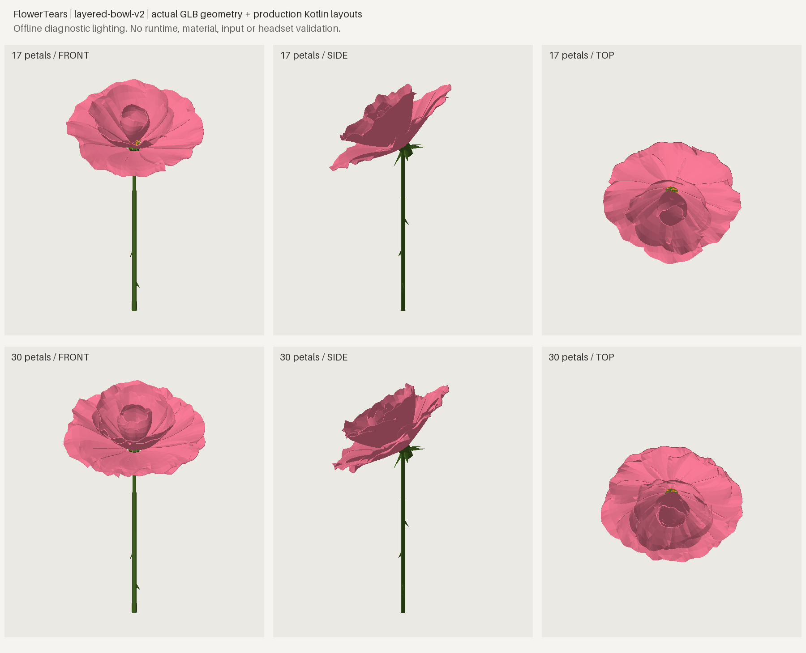

# 一瓣欢喜 / Petaluck

依据 `petaluck.zip` 中 PRD v1.8 与参考图实现的 PICO Shared Space **Volume 开发版**。工程可在 Android Studio 打开，应用使用 Spatial SDK 6.2.8、Android API 35。

应用显示名按系统语言选择：中文为「一瓣欢喜」，英文及其它语言默认回退为「Petaluck」。应用包名为 `com.unclekarma.petaluck`，从 1.0.21 起作为新应用安装；旧开发包可并存。

当前开发构建版本为 **1.0.33（versionCode 34）**。单次会话先随机抽遍八种不同的单色花，第九朵必为彩色；普通祝福在该流程内不重复。彩色花结束后请求打开 0% 沉浸度的 Mixed Stage，持续播放环绕彩色花瓣雨，近处原 Volume 保留唯一的特别祝福和“就此别过”退出按钮。全屏雨使用8个发射器，每种花色一个；发射区域水平尺寸缩小25%，总发射率每秒随机120～160片。每片下落速度随机5～20 cm/s，XYZ旋转速度分别随机±72/±50/±60 °/s。寿命延长到7～9秒，按发射器分别随机、同一发射器内一致，以保持淡入淡出各1秒；花瓣大小和其它运动参数不变。按钮依次关闭 Stage、原窗口和本应用任务。保留1.0.28的152三角面碰撞体及完成面板空白提交后停用规则。已安装；终章视觉和按钮完整退出待实景复核。详见 [寿命与淡入淡出修订记录](docs/finale-lifetime-v7.md)。

上一构建版本为 **1.0.17（versionCode 18）**：针对第二次摘完花瓣闪帧，补上重玩时完成面板的空白缓冲提交，再停用面板；新一轮提交确认绑定到面板自身的空白绘制。132项主机测试、开发/测试APK构建和静态检查通过，已安装。头显连续第二/第三轮视觉验证仍待完成。详见 [闪帧修订记录](docs/completion-buffer-v2.md)。此前的文字位置、手部旋转及花瓣雨保持；版本记录见 [docs/version-control.md](docs/version-control.md)。

冷启动在本地装配 17–30 片独立 3D 花瓣，先随机抽取八种单色花，每种只出现一次；之后必出现逐瓣彩色月季。向任意方向拉离捏住时的位置达到 4 cm 后只结算一次，花瓣继续跟手，松手后飘落淡出。两种捏合都用位移驱动同一条三骨骼花茎。摘下时花茎从受力姿态开始来回轻摆，约 0.64 秒后回到原位。最后一瓣松手后显示祝福和重玩按钮。

整朵花在容器中下移 10 cm。每次生成先隐藏装配，再用约 0.8 秒从零缩放并同步淡入；动画期间保持加载状态，不开放碰撞、悬停或摘取动作，完成后统一启用。文字位置保持独立。

花瓣判定脱离并播放音效后，仍跟随同一次拖拽移动，取消原有 12 cm 位移上限。保留该花瓣的原生输入组件直至松手，松手后才从当前位置开始原有的缓慢飘落和淡出。直接捏合、注视捏合和最后一片花瓣使用同一流程。注视捏合先计算原始手部位置相对抓取起点的位移，再转换方向和米制单位，避免把视图原点变化加入拖拽。注视捏合在断开时保存花瓣位置，后续只把相邻手部采样之间的位移累加到当前位置，每个场景帧应用一次；静止帧不重复移动，松手前先应用尚未显示的最后一段位移。直接捏合保持原有路径。

花瓣脱离时播放用户提供的 `petalDrop.wav`，从当时花瓣与花托的连接处发声。花朵先进入可操作状态，再独立准备单声道音效；音频故障不清空花朵或阻止重玩。音效使用 Android 静态短音轨与 SDK 6.2.8 的 OBJECT 空间绑定，设置为交互音效、不申请音频焦点；在写入前直接把 PCM 采样振幅缩至 0.10，音轨保持增益 1，避免依赖未经头显验证的音轨音量参数。实际播放缓冲 RMS 降低约 20 dB；这属于输入信号测量，头显听感仍待确认，不改系统音量。播完即主动停止，暂停和重玩时取消回调并清理；连续摘取不会被上一次的结束回调截断。WAV 原样保留。系统背景音并行播放、空间听感、实际音量和延迟仍待头显试听。

现同时接入 DirectPinch → drag：伸手靠近花瓣直接捏住后拖动，使用视图内三维指针坐标换算为米；GazePinch 仍沿用设备位移。抓取后锁定原花瓣、指针和坐标来源，拖出原命中范围、摘下移除碰撞体后继续跟手，松手才飘落。支持首个事件暂未报告捏合类型、随后变为 DirectPinch 的输入序列；不会将 Poke 单独当作摘取。头显运行效果仍待验证。

2026-11-10 第二次交互修订：花瓣根部收拢到花芯周围，内层直立包围、中层承接、外层展开，整朵花的生长轴朝上并略偏向观察者；花茎保持直立。「喜欢／不喜欢」在上一版 40sp 基础上再放大一倍至 80sp，固定白色。任意方向 4 cm 摘取与同一底部面板的重玩按钮保留。

针对重玩进入“花没有准备好”的反馈，公用纹理改为显式保留至场景关闭，并在复用前检查有效性、失效后重载；导入骨骼增加就绪等待，装配错误日志包含具体阶段。资源所有权回归模型及构建检查已通过，尚未取得设备异常堆栈或完成头显重玩验收。

冷启动修复：生命周期/宿主 View 的监听重绑不再销毁仍被界面记住的场景；窗口初始化回调立即返回，模型加载等待实际首帧后开始；骨骼按实际出帧就绪，不再因冷启动超过约一秒就失败。退出时取消未完成的初始化/装配任务。本次仍无设备日志，首次启动效果待头显验收。

底部全部提示现固定白色，包括加载、错误、追踪提示、结束祝福和首次操作教学；重玩按钮通过原生 Button 颜色 API 使用白色前景。已保留工程中基于 `petaluck.png` 的 PICO 图标配置。另生成的紧凑透明图标备选与提示词见 `art/app-icon/generation.md`，当前启动器仍使用 `ic_spatial_launcher` 及其立体图层。

针对“首次只有模型、没有文字”的补充修复：二维附件延后到空间视图首帧后创建，并通过更新回调与首次等待补齐绑定；两处文字 owner 绑定后再装配模型。结束时从 12 条温暖祝福中随机选一句，本轮保持不变；祝福与重玩按钮整体居中，祝福与结果共用 80sp 白字样式，容器自动增高并换行。

结束祝福现在以 600 ms 淡入；末瓣飘落完成后，“再试一次”按钮以 450 ms 淡入，完全显示后才响应点击。保留按钮占位，动画不改变居中布局或本轮祝福。

花瓣与花茎已更新为 `botanical-basecolor-v2`：八种花色分别烘焙乳白根部、自然色素渐变、细脉络与表皮纹理，使用白色材质因子保留原色；花茎、萼片、花蕊使用各自的绿色纹理、叶脉与花粉细节。继续使用 Unlit。八种底图按需加载、跨轮保留，退出场景释放。模型三角形位置与三骨骼结构未改变。

随后更新 `organic-stem-v3`：短茎改为自然曲线，轻微渐细、节部略膨大，顶部茎段朝花冠方向弯曲，花托更圆润。花芯、萼片与所有花瓣共用花冠变换，整体朝上并偏向观察者；受力与复位也共用这一路径。原三骨骼绑定点保留，静止网格本身带曲线，复位不会把它变回直杆。

当前修订 `interleaved-petals-v6` 给每种花瓣自己的收拢程度和根部位置。外层中有向中层聚拢的花瓣，中层也有向外舒展的花瓣，内层与中层的开合范围同样交叠。种子控制这些姿态在花周围的错落分布。[三朵同瓣数花朵的布局预览](art/rose-interleaved-layout-v6-review.png)

八种花色均有外、中、内三张独立底图，共 24 张。内层略深、外层略浅，瓣缘或瓣根融入局部次色。每片花瓣还会选取不同的 UV 分布和轻微明度深浅，让脉络、瓣缘粉晕与瓣根暖色的位置有所不同。每层明度变化均值相同，每轮仍共享当前花色的三张 Unlit 纹理。[花瓣变化前后对比](art/rose-petal-variation-v6-review.png)

`(N - k) % 2 == 0` 显示「喜欢」，否则显示「不喜欢」。包含偶数瓣，逐瓣严格交替，最后为「喜欢」。无账号、网络生成、选择器、开始按钮或情感概率。

## 构建

需要 JDK 21、Android SDK 35、可访问配置的 PICO Maven 仓库（当前环境使用内部 android_public 仓库）。

```bash
JAVA_HOME="/Applications/Android Studio.app/Contents/jbr/Contents/Home" ./gradlew assembleDebug
JAVA_HOME="/Applications/Android Studio.app/Contents/jbr/Contents/Home" ./gradlew testDebugUnitTest assembleDebugAndroidTest
python3 tools/verify_rose_assets.py
python3 tools/create_review_assemblies.py
python3 tools/render_rose_review.py
python3 tools/render_rose_review.py --materials
python3 tools/render_rose_review.py --stem
python3 tools/render_rose_review.py --v4
```

APK：`app/build/outputs/apk/debug/app-debug.apk`，开发包名：`com.unclekarma.petaluck`。

在可访问设备的主机环境中：

```bash
pico-cli device list --format json
pico-cli app install app/build/outputs/apk/debug/app-debug.apk --device <serial> --replace
pico-cli app launch com.unclekarma.petaluck --activity .platform.LaunchActivity --device <serial>
```

## 资产与预览

`app/src/main/assets/rose/` 包含 12 个不同形态的独立花瓣 GLB、完整三骨骼蒙皮基座、中性原型底图、八色各三层独立底图和茎叶花蕊图集。网格由本次 LLM 编写的独立形态参数/建模脚本生成，参考用户提供的图像；纹理由内置 ImageGen 制作，当前源图与完整提示词保存在 [art/textures/generation-v4.md](art/textures/generation-v4.md)，导出仅做裁切/缩放和格式转换。没有使用第三方库存模型，也没有将参数化建模描述为云端 Text-to-3D 结果。源参考图的外部使用权仍沿用用户原有授权。

外层和中层单片 412 三角面，内层单片 476 三角面，曲线基座 4,842 三角面。按最复杂单片计算的 30 瓣保守上限为 19,122 三角面。`tools/generate_rose_assets.py` 可重建模型，`docs/asset-verification.json` 记录导出文件的几何检查结果。

资产工具需要 Python、Pillow 与 NumPy；重建直接读取已保存的纹理源图，无需在线生成。

当前花茎与三层配色离线预览：复读实际 GLB 网格、UV 与贴图，使用生产 Kotlin 导出的布局、纹理路径和共同花冠朝向；不添加灯光，不代表头显运行或动态蒙皮验证。源图与最终提示词见 [art/textures/generation-v4.md](art/textures/generation-v4.md)。





旧版 S 形花茎（历史）：



八色底图沿用上一次材质版本，以下为该次离线对照（仍是旧直茎造型）：



旧的布局诊断图（旧材质）仍供几何对照：



`art/Petaluck` 和旧 `rose-production-*.png` 保留历史 Editor 审阅内容，未在本次同步到新的运行时姿态。

## 验证范围

当前构建通过 86 项单测、测试 APK 编译，以及实验 API 与 UI 样式检查。音频检查覆盖实际播放 PCM 的幅度、峰值/RMS、正负编码、重复加载和结束/暂停清理；交互检查覆盖两类捏合、逐帧增量、长距离/反向移动、末瓣松手、取消及入场锁定。既有 302 组花朵的 1,510 组入场采样包围盒位于容器内，花朵资产沿用已有结构与双 UV 检查。结束状态覆盖连续 36 轮和全部祝福文案；原生按钮 20 轮重玩的设备测试仅完成编译，设备上的显示、点击与最终音频输出仍待验证。

当前会话启动 ADB 服务返回 `Operation not permitted`，未安装、启动或在头显验证。眼手位移坐标/4 cm 阈值、蒙皮运行时语义、独立透明淡出、实际遮挡和舒适性、20 轮帧率/内存趋势尚需设备验收。当前美术为低多边形开发资产，尚未达到参考图的细腻程度；完整的逐资产三视交付和所有随机组合的穿插检查也未完成。详见 `docs/verification.md`。
