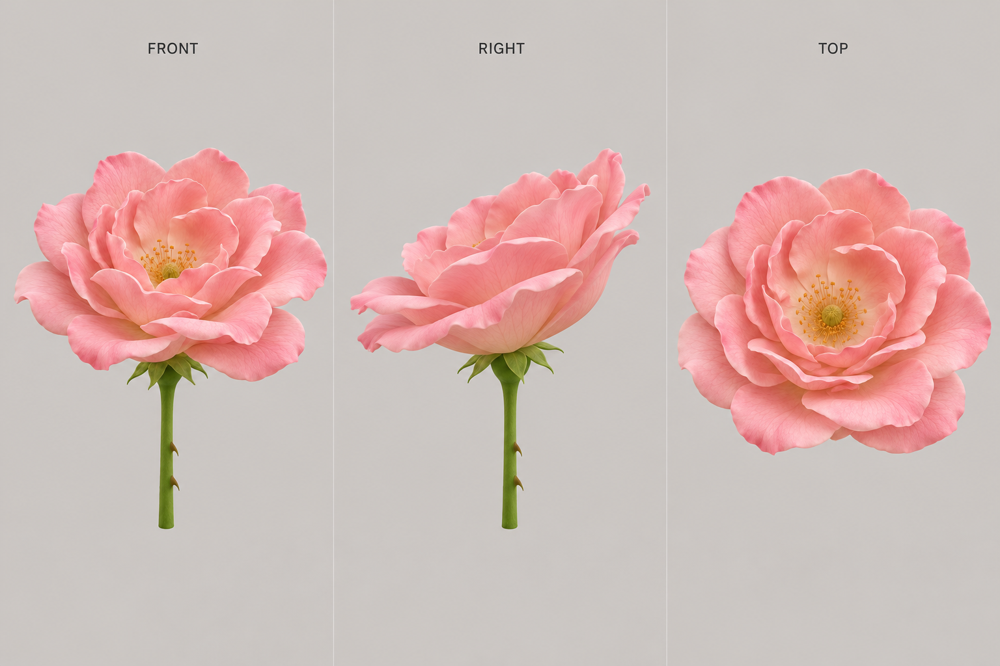
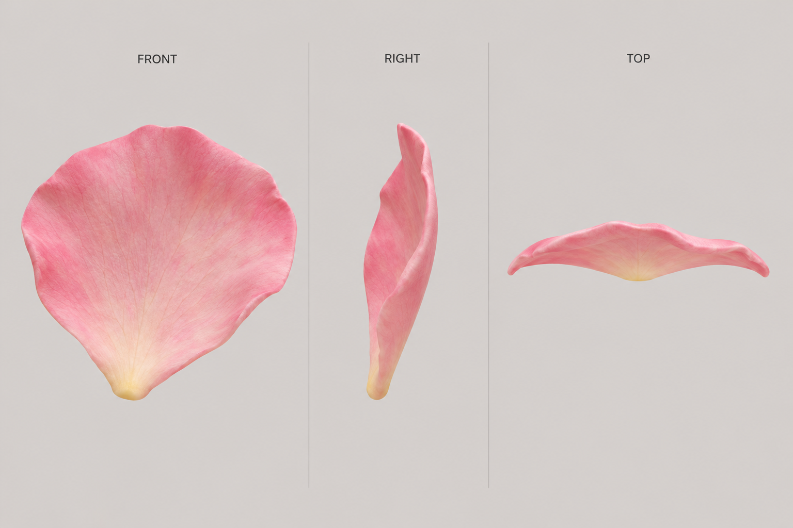
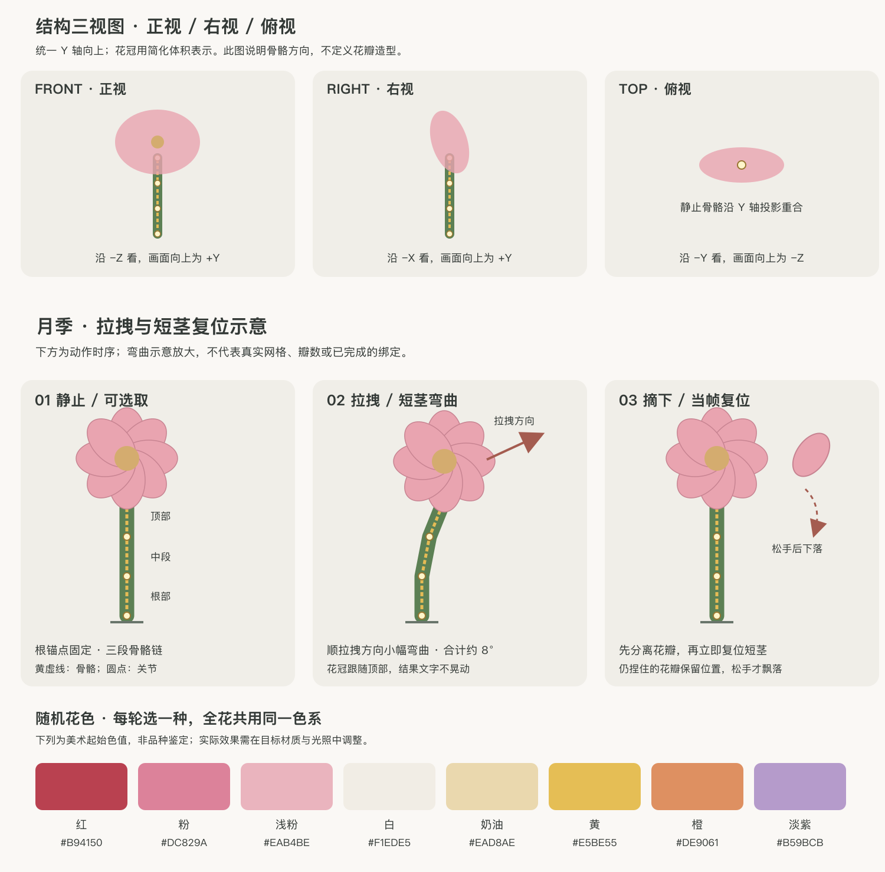
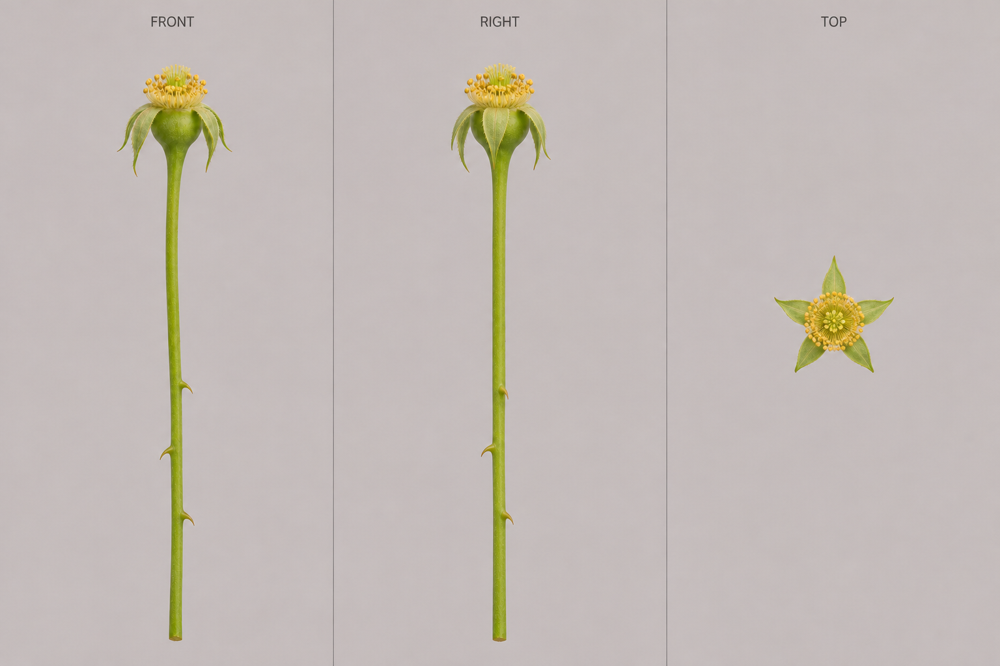

# 花瓣占卜 · Shared Space 应用 PRD

版本：v1.8 · 2026-11-10  
用途：交给 vibe coding 工具进行设计细化、资产制作与应用开发。  
应用暂名：**一瓣喜欢**。本文将 sharespace 理解为 **Shared Space（共享空间）运行模式**，不是多人联网。默认目标为支持眼手交互的 PICO 空间应用；具体 SDK 能力和设备兼容性由开发阶段核验。

> 世人皆苦。让每个人在最后，都觉得自己被爱，留一丝念想。

## 1. 产品定义

一款在真实环境中呈现一朵立体月季（玫瑰）的轻量空间应用。启动后自动随机生成一朵月季，花瓣数为 17～30 之间的整数，花色从预设的常见月季花色中随机选择。用户无需选择花型、颜色或瓣数，也无需点击开始，即可摘取。用户看向一片花瓣，捏合并轻轻拖动将其摘下，松手后花瓣缓缓向地面飘落、逐渐消失。每成功摘下一瓣，花旁的文字在“喜欢”和“不喜欢”之间交替。最后一瓣永远落在“喜欢”。

产品提供的是一个温柔、可亲手完成的小仪式。无需输入姓名、对象或问题；它不预测他人的真实感情，不生成概率、评分或关系建议。用户可以带着自己的心事进入，也可以只是玩一朵花。

**核心体验目标：** 看见花 → 自然学会摘花瓣 → 感受到轻微的期待与摇摆 → 得到确定的温柔结尾。

单轮目标时长约 45–120 秒，无倒计时，无催促。支持坐姿和站姿，允许自然垂肘的小幅手部动作。

## 2. 范围与优先级

### P0：首个完整版本必须交付

- 在 Shared Space 中呈现一朵可交互的 3D 花，保留用户的真实环境与系统空间能力。
- 仅保留月季（玫瑰），每轮随机生成 17～30 片可独立摘取的花瓣，并随机选择一种常见月季花色。
- 注视高亮、捏合锁定、拖动弯折、越过阈值摘下、松手下落淡出；拉拽时短茎通过简单骨骼动画顺着受力方向弯曲，摘下瞬间恢复原状。
- 每瓣只结算一次，结果严格交替，最后必为“喜欢”。
- 启动即玩，完成后通过“再试一次”重新随机生成月季；加载、取消、追踪丢失、暂停与恢复均有明确行为。
- 本地资产，核心体验可离线运行；可直接使用烘焙后的 Unlit 材质，PBR 非必需。

### P1：完成 P0 后再评估

- 花瓣轻响、柔和结束音，以及静音入口；无声音也能完整操作。
- 双色或渐变月季配色、更多花形变化、精细花瓣形变和更自然的飘落。
- 无眼动设备的替代瞄准方式，单独验证后再声明兼容。

### 本版不做

其他花型、手动选花或调色、账号、社交分享、多人同步、真实感情判断、付费抽签、历史结果统计、复杂场景、落地花瓣堆积和实时 AI 生成模型。启动时“生成花朵”指在本地实例化预制模型或参数化组装，不能依赖在线生成服务。

## 3. 空间设计

### 3.1 选择：一朵花，一句回应

以单一体积内容呈现花朵，少量文字与操作围绕它布置。不使用大面积主面板、数据卡片或全沉浸背景。

比较过的三个方向：

| 方向 | 优点 | 主要问题 | 决定 |
|---|---|---|---|
| 独立体积花 + 少量悬浮文字 | 摘取和飘落直接利用深度与身体动作，花是唯一焦点 | 需处理花瓣遮挡和文字对比度 | 采用 |
| 浅景深花盒 / 立体画框 | 内容集中、边界明确 | 摘花容易变成操作面板，飘落受框限制 | 不作为主方向 |
| 非惯用手托花、惯用手摘花 | 仪式感强 | 双手遮挡、托花抖动和持续抬臂增加负担 | 后续探索 |

在二维屏幕上可以点击花瓣播放动画；空间版本的价值在于辨认立体花瓣、亲手拉开与花朵的距离，并看到松手后的空间运动。因此优先投入花瓣的立体层次、选取稳定性和动作反馈。

### 3.2 初始布局与尺寸

以下均为**待真机调优的设计起点**，不是 SDK 限制或已验证舒适性结论。

| 元素 | 初始要求 |
|---|---|
| 花朵位置 | 位于用户正前方约 0.85 米，花芯略低于平视方向约 10° |
| 花冠 | 默认直径约 28 厘米；设计允许 24–34 厘米 |
| 花体 | 花冠、花托与短茎总高约 40 厘米；不要用长茎拉远视觉重心 |
| 可见内容范围 | 约宽 60 × 高 70 × 深 40 厘米，包含文字与落花动画；正式实现需容纳于平台批准的空间边界 |
| 结果文字 | 放在花冠上方，与外轮廓间隔约 6–8 厘米，避免覆盖可摘花瓣 |
| 操作区 | 启动及摘取过程中不显示选项；完成后在花体下方显示唯一主按钮“再试一次”，与花瓣命中区域分离 |
| 提示文字 | 最多两行，不与结果区争夺焦点 |

初始布局示意：

```text
             喜欢 / 不喜欢

                 🌸         ← 立体花冠与短茎

       看向一片花瓣，捏住，轻轻拉开

           启动后直接摘取，无选择区
           完成后：[ 再试一次 ]
```

示意中的图形仅用于说明位置，交付应用必须使用真正的 3D 花。

花朵根锚点在一轮中保持稳定，不持续追随头部、不自动旋转；仅拉拽时短茎与连接的花冠做小幅受力运动。结果文字与操作区不跟随骨骼晃动。初始朝向面向用户，花冠适度展开，使所有可摘花瓣能逐层露出。使用平台提供的移动、关闭等系统能力；不额外复制一套窗口管理工具。

文字使用清晰的系统字体和平台支持的对比度保障。结果字号的设计起点为约 1.2° 视角高度，辅助文字约 0.6°，以实际阅读验证调整。避免细线字体、长段文字和纯粹靠颜色表达状态。

### 3.3 视觉情绪

- 月季承担主要色彩：每轮从红、粉、浅粉、白、奶油、黄、橙、淡紫八种预设色系中随机选择，保持自然柔和的材质表现。
- “不喜欢”保持与“喜欢”一致的字体、体量和温和色调，不使用红色警告、失败震动或刺耳音效。
- 悬停只提升当前花瓣的可辨认性；不让整朵花闪烁或反复缩放。
- 最后一瓣松开后，花芯轻微亮起，文字最终停在“喜欢”，下方出现“愿你一直被温柔以待。”
- 摘尽后的花托与花芯仍需保持完整、温柔的造型，不呈现断裂伤口或枯萎效果。

## 4. 花朵、模型与材质

本项目使用 AI / LLM 辅助生成 3D 资产；生产流程、可复制提示词及整体/花瓣/无花瓣基座/骨骼的三视参考图见第 13 节。AI 生成在开发期完成，运行时复用已验证资产进行随机组装。

### 4.1 随机生成与可摘定义

本版只有月季（玫瑰），采用风格化盛开形态，避免紧闭花苞和深度遮挡。

| 随机项 | P0 规则 |
|---|---|
| 花瓣数 `N` | 从 17～30（包含两端）的全部 14 个整数中等概率抽取，包含奇数与偶数 |
| 花色 `colorId` | 从红、粉、浅粉、白、奶油、黄、橙、淡紫八个预设色系中等概率抽取 |
| 抽样时机 | 每次冷启动、完成后点击“再试一次”，或主动重新开始一轮时 |
| 花瓣版本 `variantId` | 按外/中/内层，从对应的 AI 生成花瓣库中随机选取，实例数合计恰好为 N |
| 随机关系 | 瓣数与花色独立抽样；花瓣版本按所属层抽样，全部由本轮 seed 决定，初始化后不再改变 |
| 重复规则 | 每轮独立抽样，允许与上一轮相同；“新的一朵”指新会话与重新生成，不强制颜色或瓣数不同 |

数量是交互设计设定，不追求植物学上的真实瓣数。整朵花共享一个主色系，允许同色系内深浅变化；不为每片花瓣随机挑选不同颜色。叶片、花托和短茎维持各自自然配色，不可摘。不可使用看起来可摘、实际却不可交互的残留花瓣来冒充花芯。

每片可摘花瓣必须是独立实体或独立可寻址节点，具备唯一 `petalId`、网格、材质引用、根部枢轴、初始变换和独立命中区域。不得把整朵花烘焙成一个无法分离的单体网格。

根据抽到的 `N` 在花冠的多层布局中组装恰好 `N` 片花瓣，维持盛开的月季轮廓。不能仅显示 30 片但只允许摘其中一部分，也不能从固定成品中任意隐藏花瓣造成明显缺口。可使用参数化布局或覆盖全部瓣数的预制布局，本版无需复杂生长模拟。

所有花瓣在一轮中都必须能被摘到：遮挡的内层可以暂不可选，但外层摘除后必须自然露出；最后一瓣不能藏在花背后或花芯内部。不得要求用户绕到花后方才能完成。17 瓣与 30 瓣都要保持花形可辨认和命中区域可用。

记录本轮 `seed`、`N`、`colorId`、每片花瓣的 `variantId`、变换和布局版本，便于开发复现。随机参数不作为用户选项显示。暂停恢复不得重新抽样。

### 4.1.1 资产组成：无花瓣基座 + AI 花瓣变体库

整花由两类独立资产装配，结构为：**花芯＋花茎 → 花瓣挂点 → N 片随机花瓣实例**。

- **花芯＋花茎：** 常驻的支撑组件，包含细长短茎、顶部小型绿色花托筒（hypanthium）、五片带长尖端的萼片，以及细小花蕊组成的花芯。花蕊以外围花丝和黄色花药、中央紧凑的雌蕊细节表现，不能用实心黄绿色半球代替。本文“花芯”是美术组件统称；这里展示的是开花期去掉花瓣后的结构，不是花蕾或成熟果实。全部花瓣摘完后保留该组件。
- **AI 花瓣变体库：** 多个具有不同轮廓、卷曲与非对称细节的独立生成资产。初版以 **12 个合格版本**为制作目标，外层、中层、内层各 4 个；后续可增补。每个版本需有独立生成记录，不能仅把同一网格缩放、旋转或改色后宣称是多个 AI 生成版本。
- **随机装配：** 程序先抽 N 和颜色，选择适配 N 的分层布局，再为各层从对应花瓣库取样，创建恰好 N 个独立实例。一个实例一个 `petalId`；多个实例可以引用同一 `variantId`，仍须独立摘取与淡出。
- **控制重复：** 允许版本复用以支持最多 30 片；同层一轮取样先打乱并遍历该层版本，再开始下一轮打乱。圆周相邻位置避免相同版本，必要时交换或重新分配。小幅姿态变化只用于自然感，不代替真实变体库。
- **适配检查：** 每个花瓣版本都统一根部枢轴、尺寸与材质规范，声明适用层和允许的变换范围。布局与变体搭配需验证遮挡、穿插和逐瓣可达性；不合格组合在用户看到花之前换成已验证组合，不通过删瓣修复。
- **可复现：** 同一 seed、资产库版本与布局版本应生成相同的瓣数、花色、版本序列和装配姿态。暂停恢复直接恢复结果，不重新抽取花瓣版本。

固定的是基座的装配与骨骼规范，随机的是花瓣数量、花色及合格库中的形态组合。参考图只指导美术，实际挂点和可见范围由装配数据确定。

### 4.1.2 花茎皮刺与花芯装配空间

**自然结构与美术选择分开。** 月季可有弯曲皮刺，也有少刺或近无刺的类型；靠近花朵的花梗可光滑或具腺毛，因此不是整段都必须长刺。[月季结构资料](https://www.worldfloraonline.org/taxon/wfo-0001014372)

本应用将支撑部分设计为短花枝：上部花梗保持光滑，下半段保留约 2～3 个小型、向下弯曲的皮刺作为识别细节。皮刺不是交互对象，不增加新的触碰玩法，不参与花瓣命中；其形变随所在茎段，不能漂浮脱离。图 A 是早期整花轮廓参考，皮刺与花芯规格以当前图 D 及本节为准。

**花芯收紧后仍须检验实际网格。** 高而向外放射的花蕊会侵入内层花瓣空间；改为短花丝、低矮且紧凑的花蕊群，保留花药与中央雌蕊的层次，不做大圆球。以下是面向 28 厘米花冠的工程起点，不是植物学尺寸：

- 花蕊群外包络直径初始不超过花冠直径的约 12%（约 3.4 厘米），高出装配基准面的高度初始不超过约 1.4 厘米；导入后测量并调整。
- 将花芯几何外包络向外扩张约 3 毫米作为保留空间；内层花瓣可见曲面须在其外，挂点半径根据实际包络确定，不能所有根部都插在花芯中心。
- 根部仅允许进入明确标记、被花托遮住的连接区域；可见花瓣不得穿过花药、花丝或其他花瓣表面。自然层叠遮挡与可见穿插要区分。
- 各层采用错开的角度、半径与高度；花瓣版本先按层匹配，再进行有边界的小幅随机。禁止对每个轴任意随机后直接交付。
- 花芯与未摘花瓣共用顶部运动参考系；检查静止、阈值前拉拽、最大短茎弯曲、摘下复位及取消回位。摘下时仍需保证花瓣世界姿态连续。
- 装配前进行保留空间筛查，装配后检查实际网格和可见表面。对每个 N、每个可用花瓣版本及代表性随机种子做检查；不能仅缩小碰撞盒来掩盖渲染穿模。
- 失败组合在展示前重新分配或使用已验证布局，保持本轮 N 与花色；不能删瓣补救。参考图只能指导造型，不能证明已无穿模。

### 4.2 材质策略

**默认采用烘焙后的 Unlit，PBR 非必需。** 花芯＋花茎及花瓣都可以将柔和明暗、细节和适度的自身环境遮蔽烘焙进颜色纹理，由 Unlit 材质直接显示。无需为满足验收额外制作 PBR 材质、法线/金属度/粗糙度贴图或实时灯光。PBR 仅作为可选扩展；若另行提供，也要验证对应显示效果。

烘焙使用柔和、均匀的照明，只保留组件自身的明暗；不要将相邻花瓣的投影、背景、地面阴影、强方向光或视角相关高光烘焙进去，避免摘下和转动后出现残留阴影。微小花脉和表面细节优先进入烘焙贴图，不通过增加网格面数表现。Unlit 的明暗不会随环境光实时改变，这是本版允许的视觉取舍。

花瓣采用中性可染色的烘焙底图，或为八个花色分别提供烘焙颜色纹理；不得用粉色底图硬乘所有目标颜色。八色都需实际校色，保证白、黄等浅色不被原底色污染。正反面可见、层叠和轮廓应清楚，不依赖房间照明才能辨认。

Unlit 材质仍须支持单片焦点反馈和独立透明度动画。验证混合模式、深度排序与背面显示，不能只有透明度数值变化而视觉不消失，也不能修改共享材质后让整花一起淡出。无需在用户摘取过程中切换材质类型。

### 4.3 AI 模型面数硬上限

本 PRD 的“面数”统一指**最终导出并重新导入后的三角面数（triangles）**，不是建模软件中的四边面数。所有 Text-to-3D 与 LLM 建模提示词都必须包含下列限制，不能仅在生成后口头建议优化。

| 资产 | 硬上限 | 计数范围 |
|---|---:|---|
| stem（完整花芯＋花茎组件） | ≤ 5,000 三角面 | 花茎、花托筒、全部萼片、皮刺、花丝、花药和中央雌蕊等所有渲染网格合计；拆成多个节点不增加预算 |
| 单片花瓣（每个版本） | ≤ 500 三角面 | 正面、背面、厚度侧边，以及导出时三角化或复制出来的几何全部计入；12 个版本逐个验收 |
| 30 瓣整花 | ≤ 20,000 三角面 | 5,000 + 30 × 500；复用同一网格的每个花瓣实例都计入整花预算 |

整花预算针对一轮花朵的渲染几何，已摘且仍在飘落的花瓣仍属于本轮实例；脱离时移动原实体或保持无重复渲染的等效实现，不额外复制一套可见网格。此预算不包含 UI，也不等同于帧率保证；骨骼、透明叠层、纹理与真机表现仍须分别验证。

若生成服务不能直接限制面数，必须先生成，再减面/重拓扑、烘焙并重新导出，达到上限后才能交付。保留花瓣轮廓、薄实体背面与厚度、根部枢轴，以及短茎三骨骼弯曲所需的连续拓扑；不得靠删花瓣、删背面或破坏蒙皮满足预算。源文件可保留高模用于烘焙，但运行时只加载验收合格的低模。

## 5. 完整用户流程

1. **启动：** 加载本地基座和 AI 花瓣变体库，抽取瓣数、花色与各层花瓣版本，随机装配并校验一朵月季。花朵就绪前显示“花正在盛开…”，不可操作半成品。
2. **初见即玩：** 显示“心里想着一个人，也可以只为自己。”与简短操作提示。结果区尚不显示“喜欢 / 不喜欢”。不显示花型、颜色、瓣数选择器，不设置开始按钮或必须关闭的教程。
3. **注视：** 视线落到可摘花瓣上，该瓣温和提亮。
4. **捏合并拖动：** 锁定花瓣，花瓣轻微拉扯、弯折，短茎骨骼顺着拉拽方向小幅弯曲；达到阈值后花瓣摘下、结算一次结果，短茎立即复位。
5. **松手：** 花瓣沿温和轨迹向下飘落，同时逐渐消失。用户可以继续摘下一瓣，不必等落花结束。
6. **最后一瓣：** 摘下时显示“喜欢”；松手后呈现结束文案和轻微花芯亮起动画。
7. **完成：** 结果保持，不自动跳走。最后一瓣约 1.2 秒的飘落结束后，在花下方淡入唯一主按钮“再试一次”。按钮支持注视与捏合激活，命中区域与花朵分离，具备清晰的焦点反馈。
8. **再试一次：** 点击后立即禁用按钮，清理旧轮次，重新抽取瓣数、花色和花瓣版本组合，装配新的月季。沿用当前空间位置，无需任何选择或确认；就绪后直接可摘。加载期间使用“花正在盛开…”反馈，不保留上一轮“喜欢”作为新轮结果。

完成按钮只响应出现后的新一次捏合，不能将最后一瓣的释放或仍保持的手势当作点击。新一轮重置结果、计数、花瓣状态和骨骼姿态。新花加载失败时进入可重试状态，不留下可重复触发生成的按钮。

首瓣成功后移除教学提示，不反复弹出教程。过程中不显示倒计时、情感概率或默认剩余数量；需要测试计数时通过开发日志查看。

## 6. 眼手交互契约

### 6.1 注视与选取

- 注视负责选择目标，捏合负责确认，单纯看着花瓣不会摘下。
- 可采用约 100 毫秒的焦点稳定过滤以减轻跳动；它不是凝视触发。
- 多片花瓣重叠时，优先命中当前可见且在前方的花瓣。命中区域可略大于网格，但不得穿透前方花瓣选中后方花瓣。
- 捏合开始即锁定 `petalId` 与操作手。此后视线转移不改选目标，也不要求用户持续盯住它。
- 同一时刻只允许一片花瓣处于抓取状态；另一只手的捏合不会再次摘取。
- 使用平台眼手瞄准与手势输入能力，具体 API 在实现阶段验证；不假设已经获得原始眼动数据权限。

### 6.2 拖动与摘下

采用远距选取：用户无需伸手触碰 0.85 米外的花。捏合后以该手的跟踪位移驱动花瓣局部移动，不把花瓣瞬间吸附到用户手边。

初始交互参数：

| 参数 | 默认值 / 行为 |
|---|---|
| 抖动死区 | 约 8 毫米手部位移 |
| 摘下阈值 | 从捏合起点计，朝花外侧或向用户方向的有效拉动约 4 厘米 |
| 有效方向 | 花芯到该瓣的径向外侧、朝用户方向，或两者组合；朝花芯挤压不触发 |
| 拖动映射 | 初始约 1:1，提供配置项，真机调优 |
| 阈值前形变 | 根部仍连接，以小幅转动/弯折传达拉扯，限制拉伸幅度 |
| 摘下反馈 | 花瓣轻微分离；短茎在摘下事件发生的同一更新周期恢复初始骨骼姿态，不播放延迟回弹或摆动 |

阈值前松手：取消本次摘取，花瓣与短茎约 180–250 毫秒回到初始状态，不增加计数、不改变文案。这是取消反馈，不适用于成功摘下后的立即复位。

越过阈值：保存花瓣当前世界姿态，将它从花冠运动层级分离，标记为已摘下，从可摘集合移除，立即更新结果一次，同时将短茎骨骼恢复初始姿态。脱离的花瓣继续跟随手部位移，直到松手；此时不能再接回花上。短茎复位不得带动已摘花瓣跳回花冠。

**结算点统一为“越过摘下阈值”，不是开始捏合，也不是松手或淡出结束。** 计数、文字、剩余花瓣必须在同一逻辑事件中更新。

### 6.3 短茎骨骼动画

**目的：** 用户拉花瓣时感到花朵在轻微受力；花瓣断开，受力立即解除。该动画属于 P0，必须有实际短茎骨骼与蒙皮变形，不能只整体平移或旋转花朵代替。

- 使用简单的 3 骨骼链：根部、中段、顶部。根部固定在花朵锚点；中段与顶部参与弯曲，花托、花冠和未摘花瓣跟随顶部小幅移动。
- 以捏合起点之后的有效手部拉拽位移确定受力方向，将世界空间方向转换到短茎的局部空间。朝左拉则向左弯，朝右或前后拉同理；不按视线方向或固定动画方向驱动。
- 超出位移死区后才产生明显弯曲，弯曲强度随有效拉动量递增，到摘下阈值达到上限。初始建议整条短茎合计最大弯曲约 8°，作为可调参数；不是每根骨骼各弯 8°。
- 沿短茎轴向的拉力不强行制造横向扭转；只将可投影为弯曲的分量用于骨骼姿态，不拉长茎、不改变骨骼长度。
- 阈值仍根据手部有效位移计算，不能因花冠被骨骼带动而自动触发摘下或抵消用户拉动。锁定后的花瓣及其命中归属保持不变。
- `PetalDetached` 发生时，先保留被摘花瓣的世界姿态并解除其父级依赖，再在同一更新周期将短茎恢复本轮保存的初始姿态；下一渲染帧应已复位。**不等松手，不等 fade out，不附加弹簧回弹、过冲或余摆。**
- 花瓣已摘下但用户仍捏住时，短茎保持原状，不继续跟随这一片花瓣的拖动。
- 取消拉拽时按前述 180–250 毫秒回位；追踪超时、应用失焦或新轮初始化时清除受力并复位，不能留下弯曲残留。
- 结果文字、完成按钮和花朵空间根锚点独立于该骨骼链，保持稳定。动画预算同时覆盖 30 瓣时的附属节点与命中更新。

### 6.4 松手后的运动与淡出

- 松手才开始飘落和淡出，仍捏住时不消失。
- 下落方向使用空间重力的向下方向，与头部朝向无关。
- 初始动画约 1.2 秒，向下移动约 20–30 厘米，伴随 2–5 厘米的轻微侧漂和缓慢翻转。
- 透明度从松手时开始由 1 平滑降到 0；到期移除渲染实体并释放或复用资源。
- 用户快速甩手时限制继承速度，避免花瓣飞向面部或飞出内容边界。
- 无需检测真实地面，也无需产生地面碰撞。目标是“朝地面飘落并消失”，不要求真的落到地板。
- 快速连续摘取允许多片花瓣同时淡出，但这些实体均不可再被选中。

## 7. “最后一定喜欢”的业务规则

### 7.1 正式规则

每轮开始，实际可摘花瓣数 `N` 随机取 17～30 的任一整数；成功摘下数量为 `k`，从 0 开始。为同时满足全范围随机、严格交替和最后“喜欢”，**第一片的结果根据本轮总瓣数的奇偶性确定**。

```text
初始：k = 0，结果为空
成功摘下唯一且尚未结算的花瓣：k = k + 1
若 (N - k) 为偶数：显示「喜欢」
若 (N - k) 为奇数：显示「不喜欢」
k = N：剩余数量为 0，最终结果必为「喜欢」
```

| 示例 | 第一片 | 后续 | 最后一片 |
|---|---|---|---|
| 17 片（奇数） | 喜欢 | 不喜欢 → 喜欢 → … | 第 17 片：喜欢 |
| 18 片（偶数） | 不喜欢 | 喜欢 → 不喜欢 → … | 第 18 片：喜欢 |
| 30 片（偶数） | 不喜欢 | 喜欢 → 不喜欢 → … | 第 30 片：喜欢 |

本版不再固定“第一片必须喜欢”，也不把随机范围限制为奇数。奇数瓣与偶数瓣均遵循同一公式。不能在结尾强行把“不喜欢”改成“喜欢”，不能临时增加一瓣或偷偷更改用户已看到的结果。

### 7.2 数据约束与防错

- 花瓣数以本轮真正创建成功且可交互的实体清单为准，不能只读配置中的数字。
- 开始前验证：`N` 是 17～30 的整数，实际实体数量与抽样值一致，`colorId` 属于预设花色集合，所有 `petalId` 唯一，所需网格、命中实体、短茎骨骼及蒙皮完整。
- 随机参数本身非法时直接进入错误状态，不尝试以非法参数重建；修正配置后才允许开启新轮。以下同参数重建仅适用于抽样参数合法、资产装配失败的情况。
- 装配失败时，在用户操作前用已验证的基础月季组件与布局重建，保留本轮已抽取的瓣数和花色。基础方案也无法满足约束时显示“这朵花暂时没准备好，请再试一次。”和重试入口，不能用固定瓣数或其他花型替代。生成错误后的重试沿用本次随机参数；完成后的“再试一次”则创建新轮并重新抽样。
- 不对损坏资产静默删减花瓣；偶数瓣本身是有效配置，不能为了结尾而将其改成奇数。
- 每片花瓣的结算是幂等操作。重复回调、双手输入、动画结束通知均不得重复增加 `k`。
- 中途不可随机删除、补生或自动摘除尚未结算的花瓣。
- 一轮完成后，禁止继续写入计数；新一轮使用新的 `sessionId`，旧动画回调不能影响新花。

这条规则是产品的固定设计，不能被“随机占卜更真实”的实现修改覆盖。

## 8. 状态与异常处理

### 8.1 应用状态

| 状态 | 主要内容 | 退出条件 |
|---|---|---|
| Loading | 加载与校验花朵，禁止交互 | 成功进入 Ready；失败进入 Error |
| Ready | 随机月季、简短提示，无选择区或开始按钮，k=0 | 首瓣结算进入 Playing |
| Playing | 当前结果、剩余花瓣 | 最后一瓣结算进入 FinalPetalHeld |
| FinalPetalHeld | 显示“喜欢”，最后一瓣仍可能被捏住 | 最后一瓣释放后进入 Completing |
| Completing | 最后一瓣下落，花芯亮起，显示结束文案 | 约 1.2 秒后进入 Completed |
| Completed | “喜欢”、祝福、唯一主按钮“再试一次” | 新一次点击创建会话并重新抽样，进入 Loading |
| Error | 温和错误提示与重试 | 重试成功后 Ready |

花瓣自身状态：`Attached → Focused → Pulling → DetachedHeld → Falling → Removed`。焦点移开可回到 Attached；阈值前取消从 Pulling 回到 Attached。应用进入 FinalPetalHeld 后，最后一瓣的释放事件仍必须被处理。

暂停作为覆盖状态保存进入前的逻辑状态，不通过重新创建花朵恢复进度。

### 8.2 边界行为

| 场景 | 明确行为 |
|---|---|
| 未选中花瓣就捏合 | 无操作，不计数 |
| 拉动不足就松手 | 花瓣与短茎回位，结果不变 |
| 捏合期间看向另一瓣 | 继续操作原来锁定的花瓣 |
| 两只手同时捏合 | 只接受先成功锁定的手，另一次忽略 |
| 仅视线丢失，手仍可靠 | 已锁定花瓣继续跟随；不发起新选取 |
| 手追踪短暂丢失 | 花瓣与短茎受力姿态暂留在最后可靠状态，给予约 250 毫秒恢复宽限 |
| 追踪超时，尚未摘下 | 取消拉扯，花瓣回位、短茎立即复位，不计数 |
| 追踪超时，已经摘下 | 按释放处理并飘落，保留已结算结果；若是末瓣正常进入结尾 |
| 应用失焦或被系统打断 | 未摘下的拖动取消，短茎复位；已摘下但仍持有的花瓣按释放处理，保存状态并暂停动画 |
| 返回应用 | 恢复本轮逻辑及动画，不重新随机生成、不重复摘取；短茎从无受力姿态继续 |
| 退出并重新启动进程 | 本版开始新一轮，不承诺跨进程续玩 |
| 连续点击再试一次 | 入口在建花期间禁用，只创建一个新会话 |
| 中途某实体意外丢失 | 暂停本轮并提供重开入口，不伪造一次摘取来推进结局 |

## 9. 文案与反馈

| 时机 | 文案 |
|---|---|
| 加载 | 花正在盛开… |
| 首次就绪 | 心里想着一个人，也可以只为自己。 |
| 教学 | 看向一片花瓣，捏住，轻轻拉开。 |
| 成功摘取后剩余瓣数为偶数（含 0） | 喜欢 |
| 成功摘取后剩余瓣数为奇数 | 不喜欢 |
| 最后一瓣释放后 | 喜欢 / 愿你一直被温柔以待。 |
| 重玩 | 再试一次 |
| 追踪持续不可用 | 暂时没看清你的手，放松一下，再试试。 |
| 本轮无法继续 | 这朵花需要重新盛开。 / 重新开始 |

结果切换使用约 180 毫秒的轻微透明度过渡，不滚动、不弹窗。快速连续摘取时合并或终止旧过渡，确保最终画面总与最新一次结算一致。视觉反馈不可依赖声音或触觉才能理解。

## 10. 实现交接要求

### 10.1 职责划分

- **月季配置与资产装配：** 负责无花瓣基座、AI 生成的花瓣变体库、17～30 瓣布局、八种预设花色、独立节点、材质、短茎骨骼与蒙皮、保存的初始姿态，以及随机挑选与装配。
- **会话逻辑：** 维护 `sessionId`、`seed`、`N`、`colorId`、有效花瓣集合、已摘集合、`k`、当前结果和应用状态；作为唯一事实来源。
- **输入与命中：** 负责注视候选、捏合锁定、有效拖动、取消、释放和追踪异常，不能自行修改结果文字。
- **表现层：** 根据会话事件驱动花瓣形变、短茎受力与立即复位、飘落、透明度和文案动画；动画不反向驱动业务计数。
- **生命周期：** 处理暂停、恢复、会话切换、实体回收和失效回调。

建议事件包含 `PetalFocused`、`GrabStarted`、`PullCanceled`、`PetalDetached`、`PetalReleased`、`SessionCompleted`。所有事件携带所属会话和花瓣标识；采用等效结构即可，不强制特定代码架构。

### 10.2 开发顺序

1. **交互闭环：** 先用可分离的月季灰模，以 17 瓣和 18 瓣分别验证奇偶两条路径，完成眼手选取、取消、摘下计数、短茎骨骼受力与摘下立即复位、松手淡出和最终“喜欢”。灰模只是开发阶段资产，不算最终视觉交付。
2. **资产与随机生成：** 替换成正式月季，完成无花瓣基座、12 个 AI 花瓣版本、全部 17～30 瓣布局和八种花色，验证随机组合中每片及最后一片的可达性，实现启动即玩和“再试一次”重新抽样。
3. **视觉完成：** 烘焙 Unlit 配置、文字层次、结束动画与材质透明度，并检查模型面数硬上限。
4. **稳健性：** 完成异常状态、暂停恢复、资源回收、连续重玩和真机验证。

不得在核心摘取闭环尚未可靠时先扩展商店、音乐库、用户系统或复杂环境。

### 10.3 性能与验证原则

本地复用共享材质与网格资源，按需要给动画中的花瓣分配独立透明度状态。避免大量实时光源、重后处理和全场景透明材质。

在明确目标设备后，以该设备选定的刷新率与相应帧预算验收；本 PRD 不虚构统一帧率保证。记录 17 瓣与 30 瓣月季、短茎骨骼联动、持续摘取、多片同时飘落和连续 20 轮重玩的帧表现与资源趋势，确认没有持续实体增长或可感知卡顿。

桌面原型只能验证状态和布局，不能替代真机上的眼手命中、物理尺寸、遮挡和舒适性验证。

## 11. 验收标准

| 编号 | 操作 / 条件 | 通过标准 |
|---|---|---|
| A01 | 离线冷启动 | 自动随机生成完整月季，无选择或开始按钮，加载完成即可摘；失败路径有明确重试 |
| A02 | 检查全部瓣数与花色配置 | 17～30 每个整数均可生成，实体数与抽样值一致；八个花色预设均可用且整花主色一致 |
| A03 | 只看、不捏合 | 仅出现焦点反馈，数量与结果均不变 |
| A04 | 捏合后小幅移动并松手 | 花瓣回位，不计数、不切换文案 |
| A05 | 越过摘下阈值，持续捏住 | 只结算一次；短茎下一渲染帧已复位且不余摆；脱离花瓣位置连续、不淡出，视线移开不改选 |
| A06 | 摘下后松手 | 花瓣向空间下方飘落并同时淡出，到期清除 |
| A07 | 对 17～30 全部瓣数用不同顺序摘完 | 奇数瓣首片喜欢，偶数瓣首片不喜欢；每次严格交替，最后均喜欢；顺序不影响结果 |
| A08 | 最后一瓣仍捏住 | 文字已为“喜欢”，松手事件仍有效，随后正常进入完成态 |
| A09 | 快速连续摘、重复回调、双手同时输入 | 每片最多结算一次，`k` 不超过 `N`，结果与最新计数一致 |
| A10 | 逐层摘至最后一片 | 所有可摘花瓣均能露出并被选中，无需绕到背面 |
| A11 | 注入 16/31 瓣、非整数、计数不符、非法花色、重复 ID 或缺失资产 | 用户操作前拦截；非法参数报错，合法参数的装配错误可用同参数基础月季重建；18/30 等偶数瓣不应报错 |
| A12 | 在阈值前后分别模拟手追踪丢失 | 分别执行取消或释放，计数与结局保持正确 |
| A13 | 操作中暂停并返回 | 不丢失已结算进度、不重复计数、不留下永久抓取状态 |
| A14 | 使用烘焙 Unlit 体验八种花色 | 能辨认形体与焦点；花瓣正反面、独立淡出和层叠显示正确，无邻瓣烘焙阴影残留；无需提供 PBR 才能通过 |
| A15 | 连续完成并再试一次 20 轮 | 每轮重新独立抽样、计数归零、骨骼复位，无选择步骤；旧会话不干扰，无持续资源增长；允许随机重复 |
| A16 | 坐姿与站姿真机体验 | 可自然垂肘完成小幅拖动，文字可读，结尾无需额外动作即可看到 |
| A17 | 向左、右、前、后拉动且不越过阈值 | 短茎通过骨骼蒙皮随有效受力方向小幅弯曲，根部固定；花冠跟随，文字稳定；轴向拉动无异常扭曲 |
| A18 | 取消、追踪超时、失焦与重开 | 按约定回位或立即复位，无骨骼残留；重开后无旧花瓣或旧受力影响 |
| A19 | 最后一瓣松手并注视重玩区域 | 完成动画后才出现按钮，旧手势不触发；新一次捏合激活后按钮立即禁用并生成新花 |
| A20 | 检查最终导出网格与 30 瓣实例统计 | stem 全组件合计 ≤ 5,000 三角面；每个花瓣版本 ≤ 500；30 瓣整花 ≤ 20,000；有逐资产统计，且减面后蒙皮与外观通过复验 |

业务规则应有自动化测试，遍历 17～30 全部整数的结果序列，并覆盖重复结算、会话隔离和异常资产。通过可控随机输入验证每个瓣数与花色的选择路径、两项独立抽样及重玩重新抽样；随机出现重复不能判为失败。输入、短茎方向与复位时机、舒适性需额外通过实际设备验证。

## 12. 可直接交给 vibe coding 的执行简报

请依据本文开发一个暂名“一瓣喜欢”的 Shared Space 空间应用。只保留真正可拆分的 3D 月季（玫瑰），使用 AI 独立生成的多个花瓣版本，由程序随机装配到不带花瓣的花芯＋花茎上。每次启动自动从 17～30 的全部整数中等概率抽取瓣数，从红、粉、浅粉、白、奶油、黄、橙、淡紫八种常见月季色系预设中独立等概率抽取花色。加载完成即能操作，不提供花型、颜色、瓣数选择器或开始按钮。

用眼神选择花瓣，用 pinch & drag 轻轻拉下；阈值前松手取消，越过阈值才结算。短茎使用简单 3 骨骼蒙皮链，随有效拉拽方向和力度小幅弯曲。花瓣被摘下的同一更新周期，先保留其世界姿态并解除父级关联，再立即复位短茎，不等松手，不播放余摆。摘下后仍持有时保留花瓣，松手才开始向下飘落与 fade out。

结果按成功摘下后的剩余花瓣数计算：剩余为偶数显示“喜欢”，为奇数显示“不喜欢”。因此奇数总瓣数从“喜欢”开始，偶数总瓣数从“不喜欢”开始，严格交替，最后始终是“喜欢”。不能限定只抽奇数，也不能结尾强行改答案。通过真实花瓣集合与幂等会话逻辑保证规则。

采用单朵体积花与少量清晰文字，真实环境保持可见。默认使用烘焙后的 Unlit 材质，PBR 非必需。最终导出按三角面计数：stem（整个花芯＋花茎组件）不超过 5,000，单片花瓣每个版本不超过 500，30 瓣整花不超过 20,000；将限制写入生成提示词并对实际文件复核。最后一瓣释放后保留“喜欢”，显示“愿你一直被温柔以待。”；飘落完成后出现唯一主按钮“再试一次”。用户激活后，立即锁定按钮，创建新会话，重新抽取瓣数、花色与花瓣版本组合，在原空间位置装配新月季；允许随机抽到与上一轮相同的组合。

优先验证 17 瓣与 18 瓣的完整闭环及短茎复位，再补齐所有瓣数、花色与正式视觉。实现前确认目标设备与 SDK 对 Shared Space 体积内容、眼手输入、骨骼蒙皮和透明材质的支持；如有能力缺口，应明确报告并提出最小替代方案。交付时列明月季与骨骼资产来源和使用权、构建运行方法、自动化检查结果，以及真机已验证和待验证项目。

## 13. AI / LLM 辅助 3D 模型生成方案与提示词

### 13.1 采用的生产流程

本版将 AI 生成技术用于**开发期资产制作**，应用启动和重玩仍在本地随机组装，保留即时可玩与离线能力。

分工为：图像生成模型制作外观参考，专用 3D 生成模型产出网格候选，LLM 编写或操作建模脚本，完成组件整理、精确数量装配、短茎骨骼绑定与验证。通用 LLM 的文字回答或一张渲染图不等于已生成可用 3D 模型。

推荐流程：

1. 用下方整花参考图锁定花形、材质与短茎比例。
2. 用单片花瓣参考图作为共同风格基准，通过 LLM 编排多次独立 AI 生成，制作外层、中层、内层各 4 个不同花瓣版本，形成首版 12 个版本的花瓣库。每个版本单独生成网格并验收，不只复制一个花瓣。
3. 参照图 D，单独生成不带花瓣的花芯＋花茎，保留花托、花芯与短茎的独立身份；短茎必须经过确定的骨骼与蒙皮绑定步骤。
4. 程序按本轮随机种子，从分层花瓣库挑选多个版本，精确装配 17～30 个独立花瓣实例到基座挂点，建立根部枢轴、命中代理与节点清单。**准确瓣数由程序保证，不依赖生成模型数对花瓣。**
5. 使用中性底色与统一花色参数，复用同一套几何生成八种颜色；不需要分别生成八个完整模型。
6. 导出组件包与预览，重新导入检查，再接入应用的随机生成与交互逻辑。

整花一次生成可用于探索造型，但不作为默认交付路径：生成结果必须经过独立节点与可摘取检查，不能把“视觉上有很多花瓣”当作“每片都是独立对象”。即使所用平台提供拆分功能，也需逐瓣检查，不能直接假定满足本 PRD。

例如，Meshy 的 Image to 3D 接口接收图片生成模型；其中 `texture_prompt` 用于引导纹理，不是几何、瓣数或骨骼约束。因此，下方几何提示词应交给支持几何文本输入的流程或建模代理；仅支持图片输入时上传对应的单物体参考图，将工程要求交给后处理流程。[官方接口说明](https://docs.meshy.ai/en/api/image-to-3d)

### 13.2 文档中的参考图如何使用

以下三组外观三视图使用内置图像生成工具制作；骨骼与色板图补充了正视、右视、俯视结构示意。它们是设计输入，**不是已生成的网格、绑定文件或真机效果证明**。图中花瓣数量、背面几何与细小花蕊不能直接作为工程验收依据。

**图 A：整体月季三视图（FRONT 正视 / RIGHT 右视 / TOP 俯视）。** 用于指导盛开月季的轮廓、柔和哑光外观和短茎比例；参考图的光照外观可通过烘焙 Unlit 实现，不要求运行时使用 PBR。正式模型可减少花蕊的几何数量，但需保留花丝、花药和中央雌蕊的层次，不能将它们合并成光滑大圆球。



**图 B：单片花瓣三视图（正视 / 右视 / 俯视）。** 这是花瓣库的共同风格基准，不代表全部花瓣都复用这一片。各版本需按第 13.5 节的差异描述分别生成。三视图用于对照轮廓与厚度；送入单图 Image-to-3D 前使用独立视图，不能默认把整张三栏拼图当成一个物体。注意保留凹面弧度、圆润外沿和窄根部；生成后检查背面与厚度，不能直接使用一张带背景的平面贴图代替。



**图 C：骨骼三视结构＋短茎受力/复位时序＋八种花色色板。** 用于 LLM 建模、绑定和程序交接，不应作为整张图片送入 Image-to-3D，否则文字、箭头和多个状态可能被误建模。



**图 D：月季花芯＋花茎三视图（正视 / 右视 / 俯视，不带花瓣）。** 小型绿色花托筒位于花芯下方；萼片带自然延长的尖端；外围短花丝与黄色花药收紧在低矮花芯内，中央雌蕊不高高突出；萼片适度向下收拢。采用上部光滑、下部有少量皮刺的细长短花枝。具体尺寸及间隙以第 4.1.2 节的网格检查为准。图为根据月季/蔷薇属结构校正的 AI 造型参考，不是某一月季品种的实物照片或精确解剖图，细部比例仍需在建模时审核。

术语与结构依据：《Flora of China》的月季条目记载其花托筒呈卵球形或梨形，萼片为五片且顶端延长；蔷薇属结构资料说明雄蕊着生于花托筒上缘、花柱从中央开口伸出。设计保留这些识别特征，模型可适度简化。[月季条目](https://www.efloras.org/florataxon.aspx?flora_id=2&taxon_id=200011233) · [蔷薇属结构说明](https://vicflora.rbg.vic.gov.au/flora/taxon/1279f9a7-dc28-4f4d-bab1-3014d75852d6)

程序围绕花托筒上缘的逻辑挂点装配独立花瓣。花芯、萼片与花茎不计入 N，也不参与摘取；不绘制机械插槽。花蕊细节应位于花瓣内部，避免穿插、遮挡或干扰花瓣命中。



色板是美术起点，不是具体月季品种的标准色：红 `#B94150`、粉 `#DC829A`、浅粉 `#EAB4BE`、白 `#F1EDE5`、奶油 `#EAD8AE`、黄 `#E5BE55`、橙 `#DE9061`、淡紫 `#B59BCB`。色值按 sRGB 记录，由材质流程处理到渲染颜色空间的转换。烘焙 Unlit 需实际校色；若另行提供 PBR，也须单独校色。

### 13.2.1 所有参考内容的三视图交付规范

- **覆盖对象：** 整朵月季、每个独立花瓣版本、花芯＋花茎组件，以及骨骼结构图中的三维主体，都须同时展示正视、右视、俯视。色板是二维材质说明，附在骨骼三视图下，不单独虚构空间视角。
- **视角约定：** 模型 Y 轴向上、Z 轴为正面、X 轴为右侧。正视从 +Z 沿 −Z 看；右视从 +X 沿 −X 看；俯视从 +Y 沿 −Y 看，俯视画面上方为 −Z。图片统一标 FRONT / RIGHT / TOP，并在文档中对应中文。
- **同一对象：** 三个视角必须描述同一个版本、同一姿态与同一材质，不能以三个不同花瓣或三朵不同花替代。花瓣根部位置、卷曲方向、花芯紧凑程度和皮刺位置应能相互对应。
- **投影与尺度：** 以正交投影为交付目标，单位像素比例一致，不能为了填满版面把俯视单独放大。细长花茎俯视时会被上方花芯遮挡，这是正常情况；花瓣的侧视和俯视应显示厚度及弧度，而不是三个近似正面的角度。
- **AI 参考与模型证据：** 当前图 A/B/D 是 AI 三视概念参考，尚不能保证逐个花瓣、皮刺和每一处曲率在三张投影中严格一致，也不能从图推导精确尺寸。建模后必须从同一个实际模型、固定姿态和比例重新渲染三视图，再验收一致性；不能把三张生成图片作为已经完成的工程验证。
- **每个花瓣版本单独交付：** 后续 outer_01..04、middle_01..04、inner_01..04 各自保存一张三视总览与 front/right/top 三张独立图；不将 12 个版本混在同一个三视对象中。当前图 B 是一个风格基准，尚不代表 12 个版本均已生成。
- **生成入口：** 单图 Image-to-3D 使用一张不带文字、分隔线的独立对象图；仅在服务明确支持多视图输入时，分别提交同一对象的独立视图。不要将带标题、三栏对象和骨骼标注的整页直接作为单物体输入。

为保留可直接使用的单视图输入，资料包另附此前原图：[整花单视图](model-references/rose-overall-reference.png)、[单瓣单视图](model-references/rose-single-petal-reference.png)、[紧凑花芯＋花茎单视图](model-references/rose-center-stem-compact-v3.png)。它们是补充源图，不替代上述三视图交付。

### 13.3 提示词 A：生成整花三视参考图

用途：给图像生成模型，输入整花单视图作为风格参考，生成同一月季的正视、右视、俯视总览。本次图 A 使用以下提示词；它不是实际 3D 模型的投影渲染。其中 PBR 是历史图像生成时的外观描述，不是当前模型材质要求；实际资产按第 4.2 节交付烘焙 Unlit 即可。

```text
Create a clean landscape three-view orthographic MODEL REFERENCE SHEET with three equally sized columns, labeled only FRONT, RIGHT, TOP in small dark gray sans-serif text. The SAME object is shown three times by moving only the camera, never changing the object pose, shape, component arrangement, color or scale. World axes: Y up, Z front, X right. FRONT camera at +Z looking -Z, RIGHT camera at +X looking -X, TOP camera at +Y looking -Y. No perspective, no three-quarter camera, no rear view substituted for top. Match world units per pixel across all views: top view may occupy less height, do not scale it to fill. Equal generous margins, all geometry uncropped, consistent neutral warm-gray background and diffuse soft lighting, no shadows on a ground plane, no props, no dimensions or invented measurements, no watermark. This is a conceptual reference sheet, not a certified CAD drawing. Use the supplied rose as appearance reference for the SAME fully open blush-pink garden rose with gently cupped soft matte PBR petals, restrained natural detail, short green stem, no leaves. The flower opening faces forward +Z tilted slightly upward, stem remains upright along Y. FRONT shows the open layered bloom, RIGHT shows its shallow bowl depth above the stem, TOP looks strictly down and shows the foreshortened bloom and its depth, NOT another frontal bloom. Preserve moderately open arrangement of roughly 19 broad removable petals, no tightly packed bud. Keep a compact flower center. The only update to the supplied appearance is 2-3 modest downcurved prickles on the lower stem, consistent with the current design. Same petal identities and arrangement in all views. Overall crown diameter about 28 cm, total height about 40 cm. Each column shows the entire same object, not closeups.
```

### 13.4 提示词 B：生成单片花瓣三视参考图

用途：给图像生成模型，输入单片花瓣的独立源图。同一版本展示三次投影，不是三片不同花瓣。制作其他版本时先按差异提示生成其独立源图，再沿用三视规范。

```text
Create a clean landscape three-view orthographic MODEL REFERENCE SHEET with three equally sized columns, labeled only FRONT, RIGHT, TOP in small dark gray sans-serif text. The SAME object is shown three times by moving only the camera, never changing the object pose, shape, component arrangement, color or scale. World axes: Y up, Z front, X right. FRONT camera at +Z looking -Z, RIGHT camera at +X looking -X, TOP camera at +Y looking -Y. No perspective, no three-quarter camera, no rear view substituted for top. Match world units per pixel across all views: top view may occupy less height, do not scale it to fill. Equal generous margins, all geometry uncropped, consistent neutral warm-gray background and diffuse soft lighting, no shadows on a ground plane, no props, no dimensions or invented measurements, no watermark. This is a conceptual reference sheet, not a certified CAD drawing. Use the supplied ONE blush-pink rose petal as reference. Only one petal asset exists; show three projections of this same petal, NOT three petal variants. Preserve broad rounded fan-shaped lip, slightly asymmetric rim, narrow basal attachment, thin solid rounded edge and shallow concave cupping. Petal attachment at bottom y=0; tip points +Y; concave front faces +Z; width runs X. FRONT shows full fan silhouette, RIGHT is a thin curved side profile revealing depth, TOP is a shallow curved edge-on upper projection revealing width and cupping, not another full face. At identical scale the FRONT view is about 8cm tall and 7cm wide, the RIGHT profile is 8cm tall and about 1.5cm deep, the TOP view is about 7cm wide and 1.5cm deep. Show curved surface and edge thickness, avoid flat paper look. No stem, leaves, flower center, skeleton or second petal.
```

### 13.5 提示词 C：Text-to-3D / 建模代理生成单片花瓣

用途：给支持文字几何约束的 3D 生成模型或建模代理。Image-to-3D 流程使用图 B 对应的独立视图源文件，以下内容作为补充约束；若入口不支持几何文本，就在后处理时执行这些要求。

```text
Create exactly one separate 3D garden rose petal for a real-time XR application. Broad rounded fan-shaped rim, narrow rounded attachment base, gently cupped concave surface, subtle natural asymmetry. Visible front and back, thin closed solid geometry with a softly rounded edge, no paper-thin single plane. Approximately 7 cm wide and 8 cm long before final assembly scaling. Soft nonmetallic matte surface, subtle vein relief, neutral ivory base texture suitable for runtime color tinting. No stem, leaf, calyx, other petal, background geometry, text, or baked hard shadow. Produce a clean UV-mapped mesh. Keep the attachment base identifiable for placing its pivot during post-processing. HARD LIMIT: no more than 500 triangles in the final exported petal asset, counting front, back, thickness edges and all export-generated geometry, not 500 quads. If necessary, retopologize or decimate and rebake before delivery; preserve silhouette, cupping, back surface and attachment pivot. Bake subtle veins, soft diffuse shading and restrained self-occlusion into a neutral tintable color texture, or supply the eight approved baked color variants. Use an UNLIT material directly; PBR materials and PBR texture maps are optional, not required. Do not bake neighboring petals, environmental shadows or view-dependent highlights into the texture. Reimport the exported file and report its measured triangle count. Export a real 3D file, not a render image.
```

**独立生成 12 个版本，而非由一片缩放出三类。** LLM 每次调用生成工具时，组合“上述基础提示词＋下表一行差异提示”，每次只生成一片；为每个版本保存提示词、三视总览、front/right/top 独立视图和模型文件。Image-to-3D 路径先按差异生成单物体源图及三视参考，再按服务支持方式提交独立视图，不能把三栏图直接当成三个待合并对象。

| 版本 ID | 分层 | 追加到基础提示词的差异描述 |
|---|---|---|
| outer_01 | 外层 | Broad rounded fan, shallow cupping, gently rolled-back upper rim. |
| outer_02 | 外层 | Wide oval fan, softly wavy upper rim, mildly asymmetric left side. |
| outer_03 | 外层 | Broad fan with a shallow central notch and a gentle saddle-like bend; no sharp heart shape. |
| outer_04 | 外层 | Wide rounded silhouette, right rim curled slightly outward, shallow concave center. |
| middle_01 | 中层 | Medium-width rounded fan, deeper bowl-like cupping, smooth upper rim. |
| middle_02 | 中层 | Medium-width petal, one rim gently folded inward, natural asymmetric curvature. |
| middle_03 | 中层 | Slightly taller rounded fan, soft upper-edge undulation, moderately cupped center. |
| middle_04 | 中层 | Rounded spoon-like petal, gentle diagonal twist, broad soft tip rather than a pointed tip. |
| inner_01 | 内层 | Small narrow rounded petal, gently curled inward but still visibly open. |
| inner_02 | 内层 | Small cupped fan, softly folded left rim, short rounded attachment base. |
| inner_03 | 内层 | Small oval petal, softly folded right rim, open concave front surface. |
| inner_04 | 内层 | Small open cup-like petal, mild S-shaped side profile, rounded upper lip. |

每个版本的差异应在中性灰模下可辨认，而不只是颜色不同。不得生成闭合花苞、裂口或尖刺。首版 12 个版本是制作目标，可扩展，但不能未经说明退化成一片的复制库。

三个类别共享根部枢轴、材质和相对尺寸规范，最终大小在组装时按层调节。生成结果即使带有粉色纹理，也需在制作可染色版本时中和底色，避免白色或黄色被残留粉色污染。版本选择与同层重复控制遵循第 4.1.1 节；实例可以复用资产，但必须有独立 petalId。

可选负向提示词（仅填入支持该字段的工具）：

```text
whole flower, bouquet, multiple petals fused together, leaf, pointed leaf tip, serrated edge, flat billboard, missing back surface, torn edge, holes, spikes, vase, soil, text, watermark, glossy plastic, metallic material, hard baked shadows
```

### 13.6 提示词 D：生成月季花芯＋花茎

用途：参考图 D 的三视结构，使用其独立视图源文件作为 Image-to-3D 输入，或将以下几何提示词交给 3D 生成模型 / LLM 建模代理。只生成花芯、萼片、花托筒和花茎，不生成花瓣或闭合花蕾。骨骼与蒙皮按提示词 E 单独验证。

```text
Create a real editable 3D asset of a garden rose FLOWER CENTER + SHORT STEM with all petals removed, based on the supplied corrected reference. Represent a fresh open flower, not a closed bud or a mature rose hip. Include a small green ovoid-to-pear-shaped hypanthium below the center, five sepals with naturally elongated tips, a LOW COMPACT ring of short pale-yellow staminal filaments bearing small golden anthers, and a low compact central cluster of styles and stigmas. Keep stamens gently inward rather than radiating outward. Provide empty clearance around this center for inner petals. Preserve these identifiable structures while simplifying fine geometry for real-time XR. Do not replace the center with a smooth solid yellow-green hemisphere or a flat daisy disk. Use a slender subtly tapered green stem, no oversized bulb or thick trunk. Keep the upper pedicel smooth; add two or three small downcurved prickles on the lower stem only. No petals, leaves along the stem, roots, vase, background geometry, text, or visible skeleton. Keep stem, hypanthium/calyx, and floral-center details as addressable objects. Use clean UVs, normals, matte nonmetallic materials, and continuous deformation loops along the stem for a three-bone chain. Provide virtual petal attachment transforms around the upper rim without visible mechanical sockets. Keep floral-center geometry clear of petal attachment and picking regions. HARD LIMIT: the entire stem asset, including stem, hypanthium, all sepals, prickles, stamens, anthers and pistils, must total no more than 5000 triangles after export. This is one combined asset budget, not a per-object allowance; count triangles rather than quads. Retopologize or decimate if needed while preserving compact center structure and stem deformation loops. Bake soft diffuse shading and restrained self-occlusion into color textures and use UNLIT materials directly; PBR materials and PBR texture maps are optional, not required. Do not bake shadows from removable petals or external surroundings. Reimport the exported asset and report the summed triangle count across all component meshes. Export actual mesh assets and preserve component names; adjust final scale and proportions to the approved complete rose assembly.
```

**图 D 的实际三视图生成提示词。** 输入已经批准的紧凑花芯＋花茎单视图，使用内置图像生成工具生成正视、右视和俯视参考，保留少量下部皮刺。三视图仍需在实际模型完成后重新渲染验证。

```text
Create a clean landscape three-view orthographic MODEL REFERENCE SHEET with three equally sized columns, labeled only FRONT, RIGHT, TOP in small dark gray sans-serif text. The SAME object is shown three times by moving only the camera, never changing the object pose, shape, component arrangement, color or scale. World axes: Y up, Z front, X right. FRONT camera at +Z looking -Z, RIGHT camera at +X looking -X, TOP camera at +Y looking -Y. No perspective, no three-quarter camera, no rear view substituted for top. Match world units per pixel across all views: top view may occupy less height, do not scale it to fill. Equal generous margins, all geometry uncropped, consistent neutral warm-gray background and diffuse soft lighting, no shadows on a ground plane, no props, no dimensions or invented measurements, no watermark. This is a conceptual reference sheet, not a certified CAD drawing. Use the supplied compact petal-free garden rose FLOWER CENTER + SHORT STEM as exact appearance reference, preserve its compactness and slender proportions. All rose petals absent in all three views. A low compact group of short yellow stamens and central pistils above a small green hypanthium, five small elongated sepals tucked downward, smooth upper stalk, three small asymmetrically spaced downcurved prickles on the lower half of the stem. No solid yellow-green dome, no spread-out long fireworks stamens. Keep the same sepal and prickle positions in the three views. FRONT and RIGHT show entire upright stem and compact head from perpendicular directions; TOP looks vertically down at the small circular flower center and five sepals, with the stem mostly occluded behind the head. TOP therefore should be much shorter vertically at the same scale; do NOT show a third full-length stem standing up. No flower petals, no pink parts, no leaves, no vase, no bone overlays, no fake attachment holes.
```

### 13.7 提示词 E：交给 LLM 的组装、绑定与导出任务

用途：交给能编写并执行 Blender 脚本或操作相应建模工具的 coding agent。把本 PRD、图 A/B/C/D 和已生成的花瓣库及无花瓣基座一起作为输入。下面的文件名是**待生成的交付规范**，不是本轮已经存在的模型文件。

```text
请为 Shared Space「一瓣喜欢」制作可交互月季资产。读取附带 PRD、整花/单片花瓣/无花瓣基座参考图、骨骼示意和已生成组件；先列出实际可用输入，不要假装缺失文件已经存在。通过建模工具或可执行脚本完成工作，而非仅输出操作建议。

一、资产与坐标
1. 仅制作月季，目标花冠直径约 0.28 米、总高约 0.40 米。硬上限按最终导出后三角面计：stem（花芯＋花茎，含萼片/皮刺/所有花蕊细节）全组件合计 ≤ 5,000；每个独立花瓣版本含正反面及厚度侧边 ≤ 500；30 瓣整花按实例累计 ≤ 20,000。生成提示词必须带上对应限制，超限先减面/重拓扑与重新烘焙，再导出复测；保留蒙皮拓扑与必要轮廓。
2. 制作 outer_01..04、middle_01..04、inner_01..04 共 12 个独立 AI 生成花瓣版本，保存每个版本的生成记录、正视/右视/俯视总览及独立视图；不能只复制一个网格并改尺寸。每片薄实体须有正反面与合理厚度。统一根部局部枢轴，不把花瓣中心当摘取支点。
3. 明确源文件与运行时的坐标约定；如采用 Blender 原生 Z-up，导出 glTF/GLB 时按工具规则转为 Y-up，并在 manifest 中记录。不得重复旋转或重复缩放。
4. 单独制作修正版图 D 所示花芯＋花茎，保留花托筒、萼片、花蕊与短茎的可寻址身份；不生成任何固定花瓣或闭合花蕾。保留低矮、紧凑的短花丝、花药和中央雌蕊层次，不用光滑大半球代替花芯；按第 4.1.2 节检查花芯包络、花瓣连接区域及运动中的穿插。花枝上部光滑，下部带少量小型皮刺。围绕花托筒上缘的逻辑挂点装配花瓣，摘尽后保留花芯与花茎。

二、可随机组装的结构
5. 为 N=17..30 每个整数提供合法的多层开放花冠布局。每种布局恰好 N 片，每片具有稳定且唯一的 petalId、variantId、组件引用、位置/旋转/缩放、根部枢轴和命中代理描述。
6. 运行时由应用随机抽 N、colorId，并按层从花瓣库选取版本。每层打乱遍历版本后再开始下一轮打乱；避免同层圆周相邻重复版本。允许不同实例复用同一 variantId，但不可共用 petalId。seed、资产库版本与布局版本相同时，组合与姿态须可复现。建模文件提供组件和合法布局，不用图片中的可见瓣数计数；不焊接相邻花瓣。
7. 外层摘除后内层必须能被选到。逐层检查 17 与 30 的端点布局，并验证其余全部布局；不要求用户绕到花背面。

三、短茎骨骼
8. 创建 stem_root、stem_mid、stem_tip 三骨骼链，给短茎真实蒙皮并检查权重，根部固定，中段与顶段分担弯曲。根部稳定，骨骼长度不变，合计弯曲上限初始设为约 8 度。
9. 花托、花冠与未摘花瓣通过顶部挂点跟随。其相对变换必须可读，可由应用转换成独立实体；不要让导出优化合并或丢失花瓣节点。
10. 保存每根骨骼的初始局部变换。提供静止、左右和前后受力的预览姿态，证明骨骼实际使短茎变形。运行时按照拉拽向量驱动，预览动作不是必须播放到底的固定动画。
11. 摘下事件的应用侧契约：先缓存花瓣世界姿态并解除顶部父级关联，再在同一更新周期恢复短茎初始姿态。已摘花瓣不能被复位带回原位。下一渲染帧短茎应恢复，不等松手，无弹簧余摆。未摘下就取消时才允许约 180–250 毫秒的平滑回位。

四、材质
12. 默认直接使用烘焙后的 Unlit 材质，PBR 及其法线/金属度/粗糙度贴图非必需。将细节、柔和明暗及适度自身遮蔽烘焙进颜色纹理，禁止烘焙邻瓣或环境投影与视角相关高光。提供中性可染色底图或八色独立烘焙底图，支持八个 colorId；不把一套粉色强行乘成全部花色。记录目标引擎中 Unlit 的实际映射方式，并验证导入后不依赖实时照明。
13. 单片淡出需要独立的实例透明度状态；不能修改共享材质导致整花一起消失。材质导出与目标引擎的透明混合方式需要实际验证。

五、交付与验证
14. 输出可编辑源文件、组件 GLB、17～30 瓣的布局数据、八色色板配置、asset_manifest.json、生成/装配脚本与验证报告。若目标引擎要求其他格式，保留源文件并记录转换步骤。
15. manifest 记录坐标系、单位、版本、节点名、枢轴约定、骨骼名/初始姿态、材质参数、variantId、适用层、尺寸/枢轴规范、允许变换范围、资产生成记录和布局映射。同时记录最终导出 stem 各网格及合计三角面数、每个花瓣版本的三角面数、统计工具/方法、Unlit 材质类型、烘焙纹理路径与尺寸。应用创建会话时另行记录 sessionId、seed、N、colorId 与每片的 variantId/变换。
16. 导出后在干净场景重新导入，核对命名、节点数量、单位、蒙皮、材质、正反面和骨骼姿态。检查隐藏几何、重叠面、法线错误、花瓣融合和短茎接缝。
17. 输出 17、18、30 瓣的示例预览；每个示例从同一实际模型重新渲染正视、右视和俯视，并保持投影比例一致。花瓣库每个版本和花芯＋花茎也须如此交付。检查全部 14 个 N 的数量与唯一 ID。逐个验证 stem ≤ 5,000、全部 12 个花瓣版本各 ≤ 500，并按实际实例验证 30 瓣整花 ≤ 20,000 三角面；超限明确判失败。记录纹理大小和资源大小，作为真机性能调优输入，不宣称未经测量的帧率。
18. 仅把真正生成并验证的资产标为通过。对无法自动解决的几何、绑定或导入问题给出明确失败项与最小修复建议。
```

GLB 可作为候选交换格式；Blender 的 glTF 导出文档列出了网格、材质与骨骼蒙皮等支持，但这不等于目标 Spatial 引擎已经支持本方案中的所有节点操作或运行时骨骼控制。正式集成仍需核验导入与运行时能力。[Blender glTF 导出说明](https://docs.blender.org/manual/en/2.90/addons/import_export/scene_gltf2.html)

### 13.8 提示词 F：针对生成结果的修复指令

先检查实际问题，再选择对应指令给建模代理；不要在已经合格的模型上重复重建。

| 问题 | 可复制的修复指令 |
|---|---|
| 花瓣融合成一个对象 | 保持批准的月季轮廓，改用独立花瓣组件重新装配；确保每片都有唯一节点、根部枢轴和可读取的变换。若表面已焊接，不能只按材质分组冒充拆分；重建组件后验证数量与可见性。 |
| 花冠过密，内层不可选 | 保持本轮 N 不变，调整层间深度、开口角与角度偏移，扩大逐层露出的可见面积；不得通过删除花瓣解决。 |
| 短茎只有整体转动 | 建立三骨骼链与连续蒙皮权重，固定根部，用中段和顶部骨骼产生真实弯曲；交付网格变形预览。 |
| 摘下后花瓣跳回花上 | 修正事件顺序：先保存世界变换并解开父子关联，再恢复茎骨骼，最后以新的基准继续追踪持有位移；增加脱离前后位置连续性验证。 |
| 翻转花瓣后消失 | 检查是否缺少背面、法线方向和材质背面剔除设置；按薄实体规范修复，验证翻转和淡出，不以贴背景图替代。 |
| 白花或黄花带粉色污染 | 中和原始生成底图，保留灰度明暗与纹理，再使用目标花色；检验烘焙 Unlit 的八色显示，若另行提供 PBR 再单独验证。 |
| 导出面数超限 | 按最终三角面统计定位超限网格：stem 全组件合计压到 ≤ 5,000，单片花瓣压到 ≤ 500。减面/重拓扑后重烘焙细节，保留花瓣正反面、厚度、轮廓、枢轴与短茎蒙皮拓扑；重新导出并复验，不能按四边面数或单个子节点预算冒充通过。 |
| 烘焙后出现邻瓣残影 | 隔离组件重新烘焙，只保留自身柔和明暗；去除其他花瓣及环境投影，用 Unlit 检查整花与单片脱离、翻转、淡出的效果。 |

### 13.9 AI 资产验收补充

- **G01：真实文件。** 收到可导入的 3D 组件与可编辑源文件，不能以 PNG 渲染图作为模型交付。
- **G02：生成记录。** 保留实际使用的服务/模型标识、提示词、参考图、生成时间与后处理步骤；对未使用的服务不写成已执行。
- **G03：准确结构。** 全部 17～30 瓣布局的数量与唯一节点正确，花瓣均能独立分离；基座无花瓣。图 A 的大致瓣数不参与验收。
- **G04：真实骨骼。** 短茎存在三骨骼链、蒙皮权重与初始姿态；只画骨骼线或只旋转整体对象不通过。
- **G05：交互可用。** 摘下瞬间短茎复位、花瓣空间位置连续；独立淡出不影响剩余花瓣。
- **G06：颜色与性能。** 八色色板在烘焙 Unlit 下可正确应用，形体与焦点清楚、淡出独立，无邻瓣阴影残留；不要求额外交付 PBR。30 瓣端点布局也须完成目标设备验证。

- **G07：真实变体库。** 外/中/内层各有 4 个独立生成并通过几何检查的版本，差异不只来自缩放或颜色；每个实例可追溯到 variantId。
- **G08：随机装配。** 同一 seed 和资产/布局版本可复现同一组合；不同种子可产生不同组合，允许概率性重复。恢复会话不得换瓣，花瓣实例数量始终等于 N。

- **G09：三视交付。** 整花、每个花瓣版本、花芯＋花茎均有标明正视/右视/俯视的参考总览；实际模型交付时须补同模型、同姿态、同尺度的正交渲染。方向、花瓣身份、皮刺位置或尺度不能相互矛盾；单视图或三个不同对象不算完成。

- **G10：面数硬上限。** 最终导出文件重新导入后的统计证明：stem 所有子网格合计 ≤ 5,000 三角面，12 个花瓣版本各 ≤ 500，30 瓣整花按实例累计 ≤ 20,000；报告与 manifest 一致。仅有提示词、源高模统计或生成服务的估算不算通过；减面后需重新验证骨骼、轮廓、背面与穿插。

本轮文档交付包含提示词、三组 AI 外观三视参考图与一张包含三视结构的骨骼时序/色板图；旧版半球形与花蕊过度展开的参考图已由紧凑装配版图 D 替代，不再作为建模依据；尚未运行专用 3D 生成服务，尚未生成或绑定实际 GLB/Blender 资产。

### 13.10 真实切花品种的瓣数参考

下面是育种商或种植商提供的品种参考值，不代表每朵固定相同，也不代表全部花店的统计分布。普通切花与高重瓣花园玫瑰差异明显。

| 品种 | 参考花瓣数 | 来源 |
|---|---:|---|
| Mondial（白色切花） | 30～35 | [Kordes 育种商](https://www.kordes-cutroses.com/produkt/mondial/) |
| Freedom（红色切花） | 40～50 | [Sagaro 种植商](https://sagaroflowers.com/producto/freedom/) |
| Juliet（朱丽叶，花园玫瑰） | 约 90 | [Alexandra Farms](https://www.alexandrafarms.com/varieties/juliet/) |
| Patience（花园玫瑰） | 约 165 | [Alexandra Farms](https://www.alexandrafarms.com/patience) |

本应用采用用户指定的 **17～30 瓣（包含两端，等概率随机）**，作为兼顾逐瓣交互与层叠花形的美术设定，不宣称精确复刻上述品种。布局、随机装配、交互可达性与性能验收均覆盖新的 30 瓣上限；单轮时长继续通过实际体验调优。
